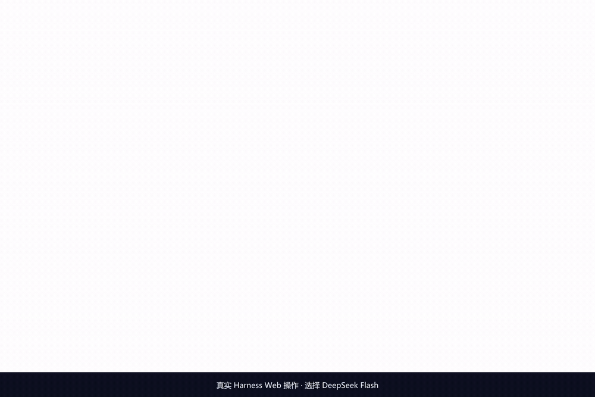

# dsh-code-review

> **让 AI 代码审查有据可查。** 核对意见中的代码引用，修复后保留问题编号，审查反复不收敛时提示人工介入。

这是一个 DeepSeek Harness 插件，适合希望保留审查依据、业务规则和修复历史的开发者。0.2.0 增加 CI 命令、团队规则、人工反馈记忆和风险处理优先级。

[真实 Web 演示](https://github.com/Yeti11H/dsh-code-review/blob/main/assets/web-demo.mp4) · [快速开始](#本地安装与启动) · [CI 接入](docs/CI.md) · [设计思路](docs/improvement-design.md) · [真实模型评测](docs/LIVE_EVALUATION.md)



上图是官方 Harness Web 的真实操作：选择 DeepSeek Flash、提交审查、查看工具结果。使用真实模型，保留等待时间；片尾延长约 6.5 秒便于阅读。[录制说明](docs/WEB_DEMO.md)。旧版脚本模型动画仍在 assets/demo.gif 中，二者不要混淆。

## 核心能力

- 🔎 **代码证据可核对**：固定 Git 快照，逐字核对文件、行号和引用原文。证据不足就降级。
- 🔁 **修复有历史**：只扫描新增变化，复核受影响的问题，保留编号与历轮状态。
- 🎯 **业务规则前置**：输入需求、规则和排除范围；不确定的业务判断保留待核查。
- 🛑 **不收敛就转人工**：三个不同代码版本仍不收敛时提示人工介入；源码未变时跳过模型调用。
- 🧩 **适配团队流程**：CI 命令、自定义规则线索、明确人工反馈记忆与风险排序。
- 📋 **保留审查记录**：源码快照、精确模型输入输出、JSON 与 Markdown 报告。

引用正确不等于结论正确。真实小样本评测发现了过度确认和复查噪声，详见评测记录。`completed` 仅表示本轮分析完成，不代表批准合并。

## 适用场景

适合已有 Git 仓库、经常修复后复查、愿意输入业务规则的团队；也适合希望在 CI 留下可追溯报告的开发者。支付、权限和删除等关键业务可作为辅助审查，最终判断仍由负责人承担。

纯格式调整优先使用 ESLint/Prettier。没有 Git 提交的独立文件暂不支持。大规模重构建议先拆分，自动分批不能保证跨模块推理完整。它也没有提供合规认证或组织审批权限系统。

插件在本地运行，但使用 DeepSeek 等云模型时，选中的代码与上下文会发送到模型服务。请按团队的数据访问规则选择模型。

## 与其他审查方式如何选择

| 关注点 | 本插件 | 手动给模型贴代码 | Copilot 等集成审查产品 |
|---|---|---|---|
| 原文引用校验 | 程序核对快照中的文件、行号和原文 | 取决于人工核对或自建脚本 | 需按具体产品版本确认，不作未经实测的断言 |
| 修复追踪 | 本地稳定编号、历史与增量复查 | 需自行保存记录和组织复查 | 按所选产品的 PR 与会话功能确认 |
| 团队业务规则 | 本轮输入＋自定义文本规则线索 | 可放在提示词中 | 按产品提供的规则配置确认 |
| 留存与数据路径 | 仓库内审计文件；源码发往所选模型 | 取决于客户端和模型 | 按产品文档和组织设置确认 |
| 成本 | 模型用量，另有运行环境成本 | 模型用量或订阅 | 按当前套餐和计费方式确认 |

本项目尚未完成相同模型、相同样本的单轮/两轮对照，不宣称准确率优于上述产品。

**兼容性：** 适配 DeepSeek Harness `0.2.2-rc.1`、Cordis `4.1.0`，升级需重新验证。npm 包名为 `@ooohyg/dsh-code-review`，无作用域的同名包属于其他作者。

## 环境

- Node.js **24.9.0 或更高版本**。
- Git，且待审仓库至少有一个提交。
- 在 DeepSeek Harness 中配置可用的模型。插件默认复用调用会话选择的 provider/model，不单独保存 API 密钥。
- Windows、macOS、Linux 均使用 Node 内置文件接口和不经过 shell 的 Git 调用。本次在 Windows 上验证。

## 本地安装与启动

### 标准插件安装（web profile，0.2.1 起）

先安装已验证的 Harness 版本及其插件管理器使用的 pnpm：

```sh
npm install -g @deepseek-ai/dsh@0.2.2-rc.1 pnpm
dsh plugin --profile web add @ooohyg/dsh-code-review
```

在需要审查的 Git 仓库中启动 `dsh web`，配置并选择可用模型，再发起审查。已经运行的 Web 服务安装后请重启。工具默认使用当前会话的工作目录；没有会话目录时回退到启动目录。该目录必须是已有提交的 Git 仓库，子目录会定位到仓库根目录。

0.2.1 包含 `dsh.bundle.patch` 和 `cordis.patch.yml`，由 profile 自动加载，无需另生成 overlay。已经使用下方手动 overlay 的用户，请选一种加载方式，避免把同一插件重复注册。

卸载：

```sh
dsh plugin --profile web remove @ooohyg/dsh-code-review
```

分类为「工具与能力」。已添加 `dsh-plugin` topic，社区目录会按自己的扫描与核验流程决定收录；npm 发布不等于已经收录。目录为 [独立社区项目](https://dsh-plugin.org/zh/submit)，与 DeepSeek 官方无隶属关系。目前只声明已验证的 Harness Web `0.2.2-rc.1`，桌面版与其他 DSH 版本尚未验证，不据此承诺可用。

### 手动 npm 安装与指定仓库

在独立工具目录运行：

```sh
mkdir review-tools
cd review-tools
npm init -y
npm install @ooohyg/dsh-code-review@0.2.1
node node_modules/@ooohyg/dsh-code-review/scripts/load.mjs "D:/code/my-project"
npx @deepseek-ai/dsh@0.2.2-rc.1 web --patch ./local-overlay.yml
```

将示例路径替换为待审 Git 仓库的绝对路径。安装包名带 `@ooohyg/`，源码项目与工具名保持不变。

### 使用交付的安装包

从 [v0.2.1 下载页](https://github.com/Yeti11H/dsh-code-review/releases/tag/v0.2.1) 下载 `ooohyg-dsh-code-review-0.2.1.tgz`。

在独立的工具目录中安装本地 `.tgz` 文件。路径请替换成下载位置：

```sh
mkdir review-tools
cd review-tools
npm init -y
npm install "D:/Downloads/ooohyg-dsh-code-review-0.2.1.tgz"
node node_modules/@ooohyg/dsh-code-review/scripts/load.mjs "D:/code/my-project"
npx @deepseek-ai/dsh@0.2.2-rc.1 web --patch ./local-overlay.yml
```

此安装方式从 npm 下载 Harness 依赖，但插件本身来自本地安装包。启动后还需要在 Harness 中配置模型。

### 使用源码

解压源码并进入插件目录：

```sh
npm install
npm run build
```

为你的代码仓库生成加载配置。将路径换成真实 Git 仓库的绝对路径：

```sh
npm run overlay -- "D:/code/my-project"
```

macOS/Linux 可填写 `/Users/you/code/my-project`。命令生成 `local-overlay.yml`，里面会写入插件和仓库的绝对路径。

启动官方 Harness：

```sh
npx @deepseek-ai/dsh@0.2.2-rc.1 web --patch ./local-overlay.yml
```

选择已配置的模型，在聊天中输入：

> 请调用 start_review 审查当前仓库的未提交改动。需求：新版本构建完成后发布知识索引。业务规则：旧版本不能覆盖已经发布的新版本；索引未构建完整时不能参与检索。本次不涉及查询排序策略。不要修改源码，也不要运行测试。

工具返回会话 ID、问题数量、报告路径和 Markdown 报告。随后可以说：

> 我已经修复，请调用 recheck，sessionId 使用刚才返回的会话 ID，不执行测试。

查看历史：

> 请调用 check_review_status 列出本仓库的审查会话。

插件载入后注册四个模型可调用工具：`start_review`、`recheck`、`check_review_status`、`set_review_issue_status`。这些是模型工具名。0.2.0 另提供 `dsh-review` 非交互命令，用于 CI 发起新审查；复查仍通过 Harness 工具进行。详见 [CI 接入](docs/CI.md)。

## 工具参数

### start_review

```json
{
  "target": "unstaged",
  "requirement": "新版本构建完成后发布索引",
  "businessRules": ["旧版本不能覆盖已发布新版本"],
  "outOfScope": ["查询排序策略"]
}
```

`unstaged` 是沿用原方案的兼容名称，实际包含 **暂存＋未暂存＋非忽略的未跟踪文件**。`working` 是同义值。填 `main` 等分支名时，比较 `merge-base(main, HEAD)` 与已提交 HEAD；不会把脏工作区混入分支审查。

需求或业务规则可以留空，但依赖业务确认的结论会标成待核查，不由模型自行补齐。

### recheck

```json
{ "sessionId": "RV-实际返回的UUID", "executeTests": false }
```

没有代码变化时保留原结果，不增加轮次。变化包括相关上下文文件；并不限于原 PR 的几行。原问题若仍存在，保留稳定编号；已解决问题重新出现时，重新打开原编号。

复查扫描使用上一轮到当前快照的变化，代码证据引用当前快照。旧问题不能仅凭行号变化或代码消失就自动解决。存在未知影响时交给人工检查。

### check_review_status

```json
{ "sessionId": "RV-实际返回的UUID" }
```

省略 `sessionId` 列出会话。指定 ID 时同时检查代码是否已变化；已过期的报告会明确标记。

### set_review_issue_status

```json
{
  "sessionId": "RV-实际返回的UUID",
  "issueId": "ISS-001",
  "action": "wont_fix",
  "reason": "负责人明确接受此风险，原因是……"
}
```

`action` 取 `wont_fix`、`false_positive` 或 `reopen`。学习模式见 [团队定制说明](docs/CUSTOMIZATION.md)。通过 Harness 批准后记录原因，接受的风险仍在报告中可见。它只记录使用者的决定，不替代组织的负责人权限管理。不要让模型为了结束审查而自行接受风险。

## CI、风险排序与团队定制

- [CI 命令和 GitHub Actions 示例](docs/CI.md)：JSON 产物、退出码与用量。
- [风险、自定义规则与反馈记忆](docs/CUSTOMIZATION.md)：规则命中仅是线索，风险分数不批准合并，反馈不自动屏蔽问题。

## 可选测试验证

只有安装者在配置里指定测试命令，且使用者明确请求并通过 Harness 批准，才会执行。没有批准服务时拒绝执行。

在 `local-overlay.yml` 的 `config` 中增加：

```yaml
        testCommands:
          - file: node
            args: ["--test", "tests/index.test.js"]
        testTimeoutMs: 60000
```

然后请求 `recheck` 且 `executeTests: true`。命令通过参数数组启动，不接受模型生成的 shell 脚本。Windows 上不要直接配置 `npm.cmd`；可用 `node` 运行测试入口，或配置 Node 与 `npm-cli.js` 的完整路径。

测试会执行仓库代码，可能产生输出文件或副作用。报告记录真实命令、退出码、输出与对应快照；测试通过不会自动证明每条问题成立或解决。分支快照与工作区不一致时拒绝运行测试。测试更改源码会使报告过期。

## 配置与覆盖限制

可在 overlay 的 `config` 中设置：

| 配置 | 默认值 | 作用 |
|---|---:|---|
| `cwd` | 当前会话目录；缺失时为启动目录 | 安装者明确指定的仓库优先；子目录自动定位到 Git 根目录 |
| `provider` / `model` | 调用会话的选择 | 必须一起设置，或一起省略 |
| `maxChangedLines` | 500 | 每批最大改动行数；大文件也拆分 |
| `maxFileBytes` | 512000 | 单个源文件读取限制 |
| `maxSnapshotBytes` | 20000000 | 当前源码快照的字节预算 |
| `maxSourceFiles` | 2000 | 当前源码快照的文件数量预算 |
| `maxPromptChars` | 90000 | 单次请求字符上限，至少 4000 |
| `maxCandidates` | 20 | 每批疑点上限，超限明确报错 |
| `modelTimeoutMs` | 120000 | 单次模型调用超时 |
| `testTimeoutMs` | 60000 | 单条测试命令超时 |
| `customRules` | [] | 团队提供的正则核查线索 |
| `learningMode` | false | 复用仍匹配的明确人工反馈 |

二进制、符号链接、过大文件、依赖和生成目录、`.env` 与常见私钥文件默认排除。因读取限制遗漏的文件写入报告并转人工。文件名过滤不能识别所有硬编码秘密；使用者应按所在团队的数据访问规则配置 Harness 模型。

上下文通过相对导入、函数名文本搜索和有界代码窗口补充。**第一版没有完整 AST、跨语言调用图或自动证明功能。** 上下文文件存入快照，但并不意味着模型审查了每个文件的每一行。模型请求中不提供任何工具。

## 存储与审计

```text
你的仓库/
└── .dsh-review/
    ├── RV-<UUID>.json
    └── RV-<UUID>.md
```

JSON 包含源码快照、所有轮次、精确模型输入/输出和运行记录；Markdown 供人阅读。模型请求在发送前落盘，失败或取消也保留未完成状态。会话文件通过临时文件＋替换写入；仓库级互斥锁阻止并发复查覆盖。

这些文件包含代码，应在目标仓库的 `.gitignore` 中加入 `.dsh-review/`。插件会主动排除自己的输出，避免报告不断进入下一轮审查。插件不自动修改 `.gitignore`。

进程异常退出可能留下 `.dsh-review/.lock`。确认旧进程已经停止后再手动删除该空目录；不要在仍有审查运行时清锁。

## 开发、验证和发布

```sh
npm run typecheck
npm test
npm pack
```

测试使用真实临时 Git 仓库、官方 Cordis / tools / LLM 运行时及本地脚本模型。并发示例通过可控暂停点实际复现旧覆盖，并验证条件发布修复。

**脚本模型测试验证工程行为，不是 DeepSeek 检出率。** 已完成一次真实接口的小样本评测，发现有效风险线索，也发现证据不足的确认结论，见 [评测报告](docs/LIVE_EVALUATION.md)。这不是稳定准确率或成本基准；复测方法见 [examples/live-evaluation.md](examples/live-evaluation.md)。

环境、既有版本检查结果与限制见 [docs/VALIDATION.md](docs/VALIDATION.md)。

`npm pack` 生成可安装的 `.tgz`。源码与试用安装包通过 [GitHub 仓库](https://github.com/Yeti11H/dsh-code-review)、[Release 页面](https://github.com/Yeti11H/dsh-code-review/releases) 和 npm 作用域包 `@ooohyg/dsh-code-review` 分发。项目未自动向社区发帖。

## 与原计划的调整

- 采用真实 `name/inject/apply`、`defineTool` 与 `ctx.llm.stream()`，不使用示意 API。
- 只声明实际所需 Harness peer 包；没有额外业务运行时依赖。Harness 自身仍有传递依赖，不宣称绝对零依赖。
- 无法通过引用校验的结论降级，而非宣称能够杜绝幻觉。
- 收敛检查包含最新一轮，无变化复查保留人工介入状态。
- 维护性问题和可选建议分开判断，报告分组不重复。
- `completed` 不等于允许合并；发布和风险决策仍由人负责。

## 官方接口依据

- [Your first plugin](https://github.com/deepseek-ai/deepseek-harness/blob/master/docs/user/develop/basic/index.md)
- [Build a tool](https://github.com/deepseek-ai/deepseek-harness/blob/master/docs/user/develop/basic/tool.md)
- [Tool authoring reference](https://github.com/deepseek-ai/deepseek-harness/blob/master/docs/cookbook/adding-a-tool.md)
- [LLM runtime](https://github.com/deepseek-ai/deepseek-harness/tree/master/packages/llm/llm)

MIT License。审查方法参考文中讨论的两轮核查、业务上下文和复查收敛原则，未复制各团队的私有实现。
