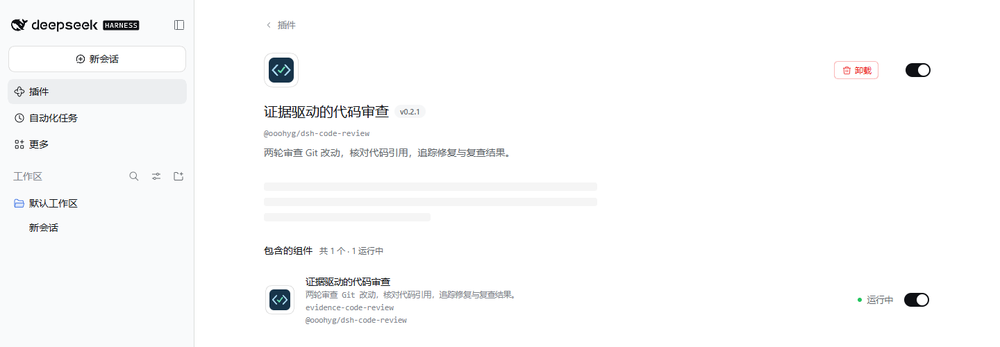

# 0.2.1 标准插件安装验证

日期：2026-11-11。环境：Windows，Node 24.16.0，Harness 0.2.2-rc.1，pnpm 11.25.0。

## 修复范围

- package.json 声明 `dsh.bundle.patch`、`engines.dsh`、图标与资源导出。
- npm 归档包含实际的 cordis.patch.yml，插入 `@ooohyg/dsh-code-review`，沿用原有 `evidence-code-review` ID。
- 标准安装后无需手动 overlay。默认使用工具调用所属会话的 `session.header.cwd`；显式 `config.cwd` 优先，无会话目录才回退进程目录。
- README 提供 web profile 的安装、启动、卸载、模型配置说明，注明云服务的数据路径及平台验证范围。

## 已完成的检查

- 类型检查通过。
- 本地 46 项测试：45 通过，0 失败，1 项因本机 Windows 符号链接权限跳过。
- 新增集成测试：同一插件实例分别审查两个会话对应的不同 Git 仓库，复查状态可以读取；安装者固定目录优先于会话目录。
- 独立 DSH_HOME 中使用官方 `dsh plugin --profile web add <本地0.2.1归档> --ignore-scripts` 成功。实际启用列表包含本插件，不写入用户的日常 profile。
- 官方 `loadProfileDirectory` 成功识别安装的 bundle，无 skippedBundles；`composeEntries` 产生正确的插件名、ID 与空配置。
- 启用官方 web 模板与该 bundle 后，`dsh web --dump-config` 返回 0，包含本插件且无 stderr。
- 从最终归档独立安装后，官方 Cordis、tools 与 LLM runtime 可注册四个审查工具。

这些检查不需要真实模型请求。0.2.0 的真实 Web 模型操作另见 WEB_DEMO.md。此次不重复进行付费模型评测。

## 发布后的公共安装与实际界面

- npm `latest` 已更新为 0.2.1，公共下载归档与 GitHub Release 的安装包 SHA256 一致。
- 在另一个独立的 DSH_HOME 中直接运行 `dsh plugin --profile web add @ooohyg/dsh-code-review --ignore-scripts`，从公共 npm 成功安装 0.2.1，自动选中 bundle，官方 profile 加载无跳过项。
- 官方 Harness Web 实际启动，浏览器插件详情显示中文名称、图标、v0.2.1，包含的组件为 `evidence-code-review`，状态「运行中」。该界面验证使用本地发布归档；公共 npm 的标准安装另行验证。截图仅裁去来源信息和空白区域，未替换界面内容。
- [GitHub Actions 42988949133](https://github.com/Yeti11H/dsh-code-review/actions/runs/42988949133)：Ubuntu 46 项通过、Windows 46 项通过，两组均 0 失败、0 跳过，类型检查和 pack dry-run 通过。
- 最后查询社区公开目录时，仍没有 `Yeti11H/dsh-code-review`，需要等待目录后续扫描与核验。

## 收录与兼容边界

仓库已公开、添加 dsh-plugin topic，根目录有 package.json，导出 apply(ctx)，README 包含完整的标准安装命令。上述条件用于配合社区目录的自动发现，不代表已获目录核验。

发布到 npm 后，需等待目录自己的同步与验证。只有实际目录中出现 `Yeti11H/dsh-code-review`，才能声称已收录。其他作者的同名仓库不能作为本项目的收录证明。目录是独立社区项目，与 DeepSeek AI 无隶属关系。

桌面版、其他 DSH 版本及其他操作系统的一键安装尚未验证。未添加通用兼容声明，也未向外部 Issue 或评论自动发送信息。
